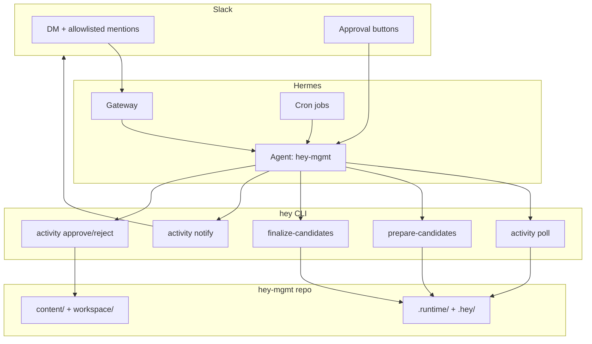
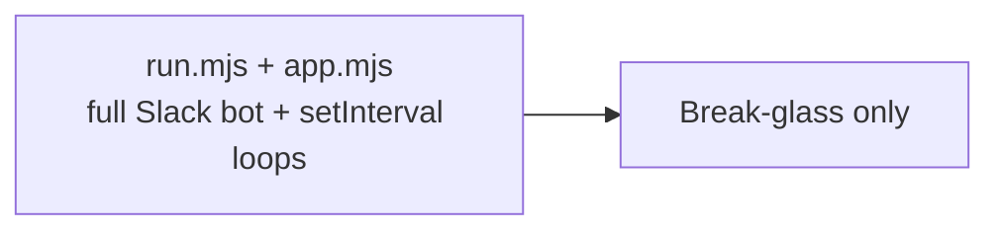

# Hermes Activity Pipeline Architecture

## Current Production Topology

## Deprecated Path

`run.mjs` is intentionally gated by `SUPEREARN_ENABLE_LEGACY_ACTIVITY_RUNTIME=1`.

## Key Differences from the Legacy Runtime

| Aspect | Legacy | Current |
| --- | --- | --- |
| Conversational Slack | custom Bolt bot | Hermes native Slack |
| Scheduler | `setInterval` loops | Hermes cron |
| Approval flow | handled inside full runtime | native Slack text commands |
| Repo reasoning | legacy `SlackAgentService` | repo-scoped Hermes agent |
| Normal background workload | full runtime + sidecars | Hermes gateway + cron |
| Fallback behavior | same as default | explicitly gated break-glass path |
